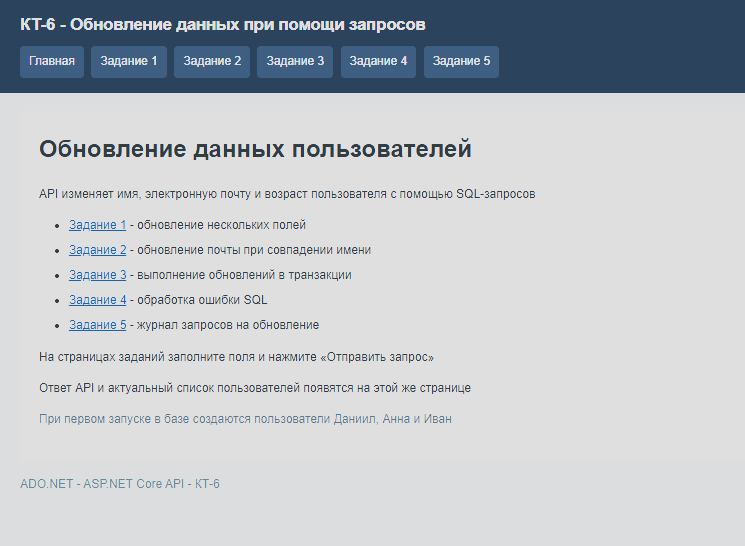
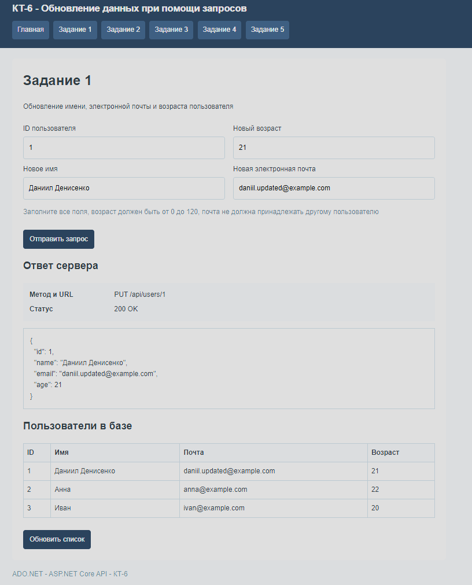
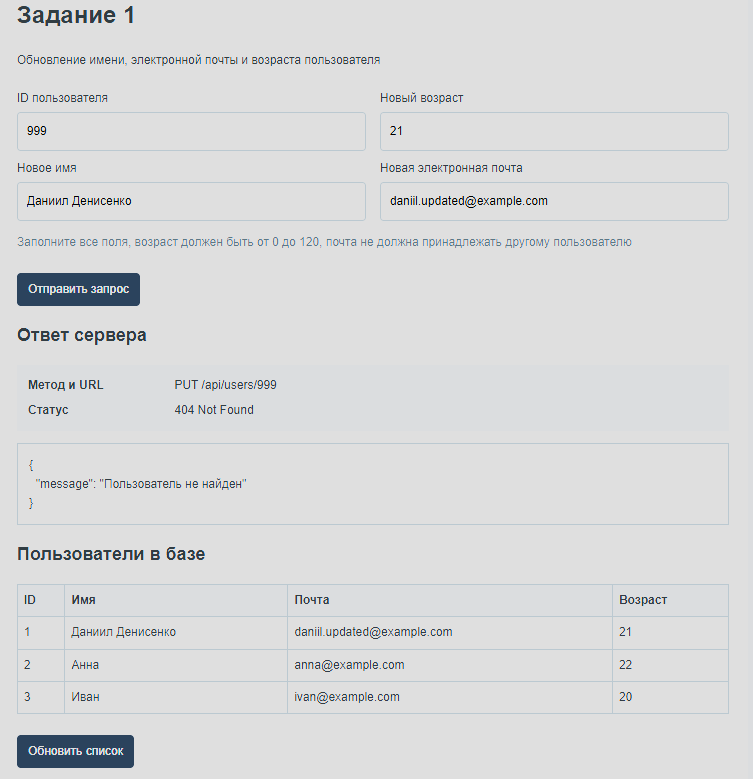
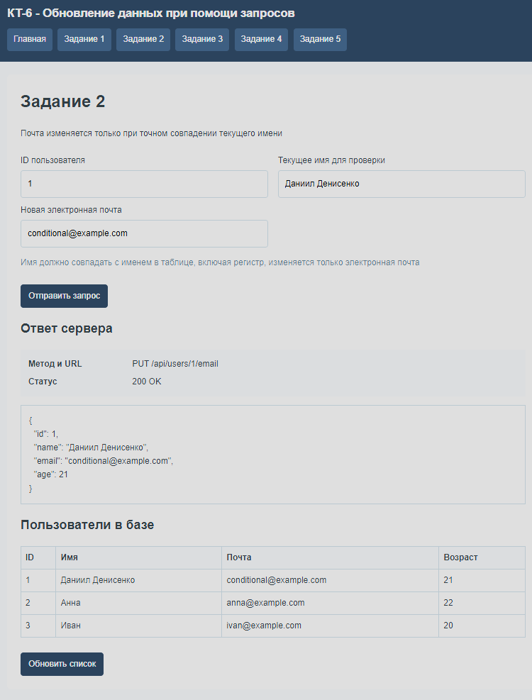
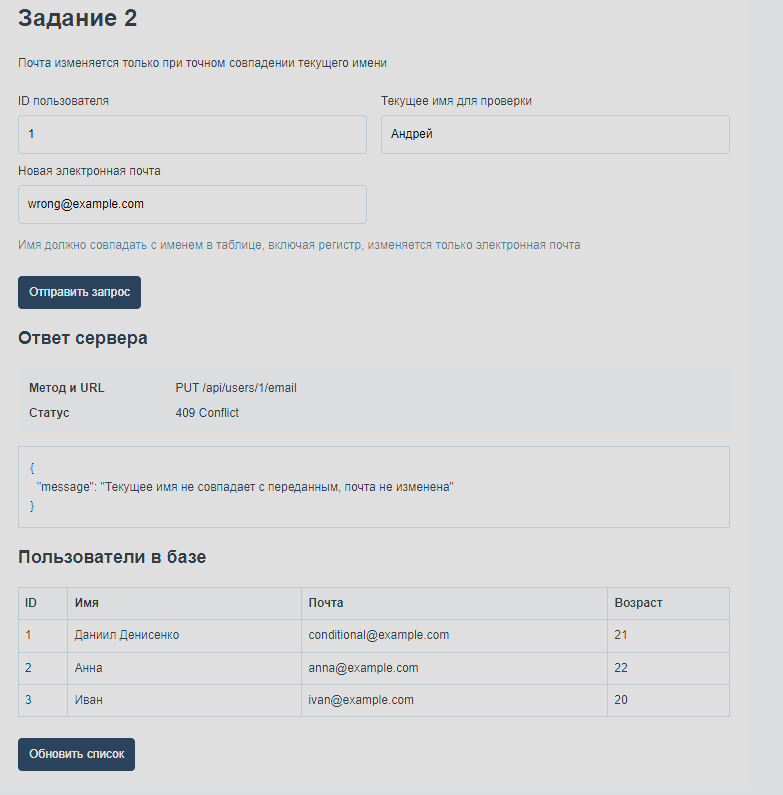
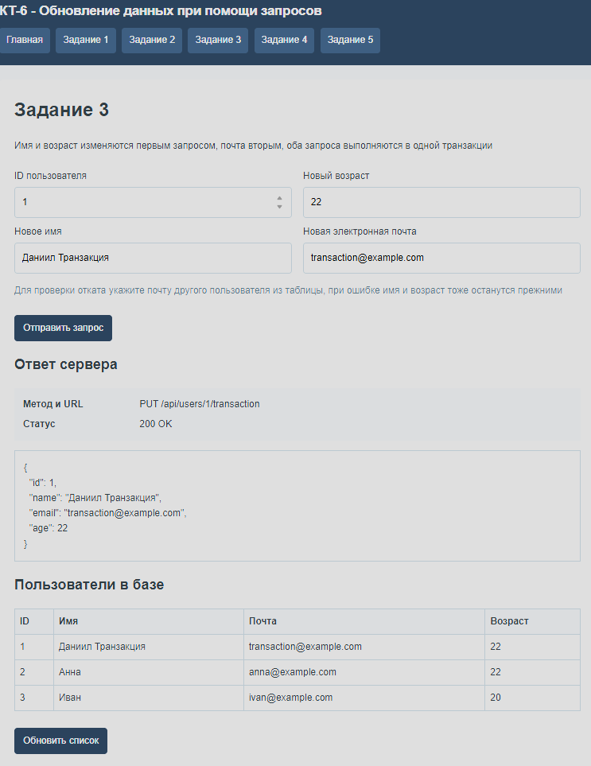
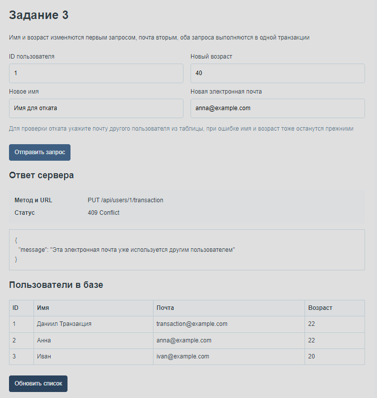
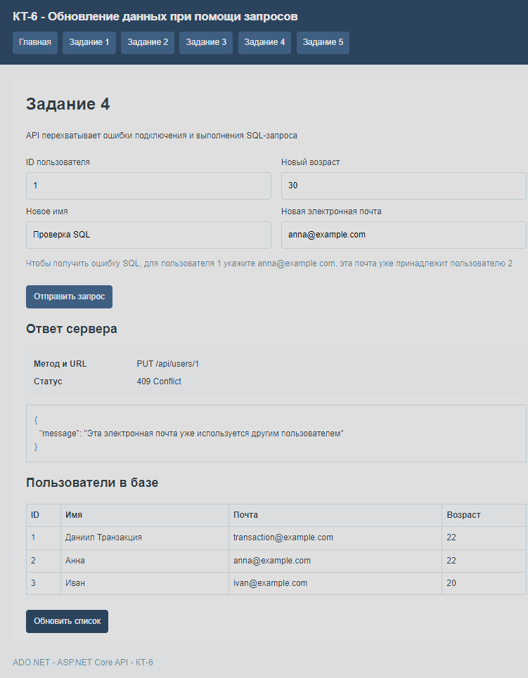
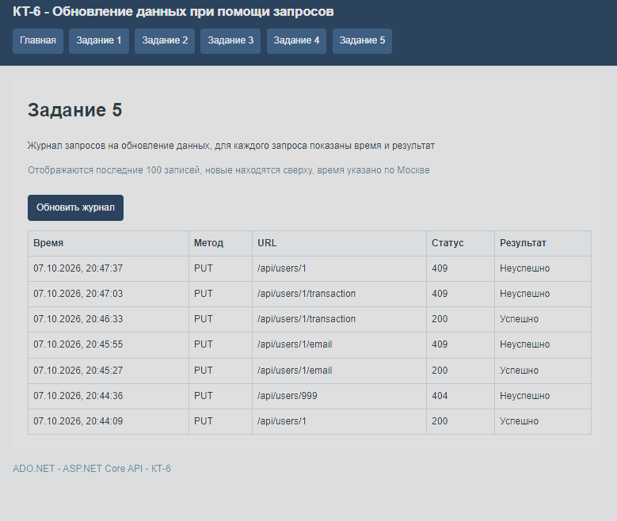

# КТ-6 - Обновление данных при помощи запросов

Студент - Денисенко Даниил Евгеньевич  
Группа - 4п4.23 NET  
Дисциплина - ADO.NET  

### Задания

**Задание 1: Обновление нескольких полей**

Измените приведенный в презентации пример, добавив в таблицу Users новое поле Age (возраст). Расширьте API метод, чтобы он также обновлял возраст пользователя.

**Задание 2: Условное обновление**

Создайте API метод, который обновляет электронную почту пользователя, только если текущее имя пользователя совпадает с предоставленным. Для этого вам потребуется добавить условие WHERE в SQL запрос.

**Задание 3: Транзакции**

Модифицируйте один из методов так, чтобы он использовал SQL транзакции. Это полезно, если ваши обновления включают несколько шагов, и вы хотите гарантировать, что либо все шаги выполняются успешно, либо ни один из них.

**Задание 4: Обработка исключений**

Добавьте в метод обработку исключений для отлова ошибок, связанных с подключением к базе данных или выполнением SQL запроса. Убедитесь, что в случае ошибки возвращается соответствующий ответ API.

**Задание 5: Логирование**

Реализуйте простую систему логирования, которая записывает информацию о каждом запросе на обновление данных, включая время запроса и результат (успешно или нет).

*Доп. информация в презентации*

Исходный материал: 3.6.КТ-6 Обновление данных при помощи запросов.pptx
Для базы использовал SQLite, данные меняются SQL-запросами через ADO.NET

### Задание 1

Добавил поле Age в таблицу Users
Имя, почта и возраст обновляются одним SQL-запросом

Главная страница с переходами к пяти заданиям

Обновление пользователя с ID 1, в ответе и таблице отображаются новое имя, почта и возраст

При обновлении пользователя с ID 999 API возвращает статус 404 и сообщение «Пользователь не найден»

### Задание 2

Добавил проверку имени в условие WHERE
Почта меняется только при совпадении имени с записью в базе

При совпадении имени почта обновляется, имя и возраст остаются прежними

При несовпадении имени API возвращает статус 409, почта в базе не меняется

### Задание 3

Объединил два обновления в транзакцию
Если один шаг не проходит, все изменения отменяются

Успешная транзакция сохраняет новое имя, почту и возраст пользователя

При попытке указать занятую почту транзакция откатывается, имя и возраст тоже остаются прежними

### Задание 4

Добавил обработку ошибок подключения и SQL-запросов
При ошибке API возвращает сообщение и соответствующий статус

Попытка указать почту другого пользователя возвращает статус 409 и сообщение об ошибке, данные не меняются

### Задание 5

Добавил журнал запросов в App_Data/updates.jsonl
Записываются время, адрес запроса, статус и результат обновления

Журнал показывает успешные запросы со статусом 200 и неуспешные со статусами 404 и 409

